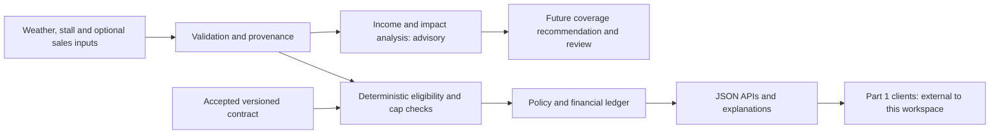

# Part 2 architecture and integration guide

## The boundary

**Part 1 owns experience:** mobile/web screens, dashboards and customer-facing payment UX.

**Part 2 owns intelligence and authority:** data validation, income/weather research, contract versions, policy eligibility, caps, billing/settlement orchestration, evidence, audit and explanations. A frontend requests and displays these results; it must not invent balances or recompute entitlements.



The diagram is the target architecture. Sales analysis/recommendations, official evidence scheduling and real-provider adapters are not all implemented. Current decisions use labelled simulation inputs; ingestion snapshots do not automatically settle claims.

## Where to work

| Responsibility | Current files | Important distinction |
|---|---|---|
| Contract authority | `src/daycover/contracts.py`, `contracts/` | Only the frozen M1 version has an executable pilot adapter |
| Decisions | `src/daycover/pilot.py` | Uses registered terms, never mutable ML/research defaults |
| Policy/financial storage | `pilot_store.py`, `ledger_repository.py`, `ledger_migrations.py` | Canonical ledger; exact cents, atomic cap allocation and append-only history |
| Identity and consent | `auth.py`, `identity_api.py`, `scripts/manage_local_identity.py` | Local accounts and resource grants; no connected official identity provider |
| Mock settlement | `settlement.py`, `settlement_provider.py`, `settlement_api.py` | Atomic decision/outbox, current recipient/source checks, confirmed mock cash and local wallet mirror; no real rail |
| Billing | `billing.py`, `billing_provider.py`, `billing_api.py` | Exact simulated obligations, separately authorized mock collections and confirmed-outcome reconciliation |
| Policy lifecycle and evidence decisions | `policy_lifecycle.py`, `evidence_engine.py`, `lifecycle_api.py` | Immutable simulation terms, reviewed entitlements and replay; no payment execution |
| Daily evidence | `daily_evidence.py`, `evidence_api.py`, `scripts/daily_weather_evidence.py` | Current immutable daily versions, reviewed closures and bounded fallback; no settlement |
| Weather validation/ingestion | `ingestion.py`, `weather_ingestion.py`, `scripts/ingest_nea_telemetry.py` | Raw API pages, provisional observations/revisions and saved cursors; five-minute rain is not a daily total |
| Historical weather/replay | `data.py`, `rules.py`, `engine.py` | Research/calendar-year replay is separate from enrolled-policy settlement |
| Income/pricing models | `src/pricing/`, training scripts | Existing research assumptions and synthetic labels need validation before reuse |
| API/read models | `src/daycover/api.py`, `dash.py` | `dash.py` serves backend research data, not a frontend dashboard |
| Older Postgres helpers | `db.py`, root migration files | Compatibility paths; do not treat seeded counters as canonical claims |

## The interface to Part 1

Run the server and inspect `/docs` for exact schemas. Main routes:

| Operation | Route | Meaning |
|---|---|---|
| Contract discovery | `GET /api/v1/contracts` and `/{version}` | Read-only simulation/research/proposal catalogue |
| Selected M1 terms | `GET /api/v1/contract?version=daycover-pilot-m1-2026.11-v1` | Explicit terms; never silently substitute another design |
| Quote | `POST /api/v1/quotes` | Requires authorized stall and `contract_version`; indicative quote creates no policy |
| Simulation enrolment | `POST /api/v1/policies` | Requires authorized, reviewed local stall, explicit version and terms acceptance |
| Coverage | `GET /api/v1/policy/{stall_id}` | Accepted term, status, remaining caps and billing projection |
| Simulation | `POST /api/v1/triggers/simulate` | Scoped service only; labelled synthetic event; no bank instruction |
| History | `GET /api/v1/payouts/{stall_id}` | Receipts, decisions and reconciliation |
| Ledger readiness | `GET /api/v1/ledger/health` | Reports selected storage backend readiness |
| Integration boundaries | `GET /api/v1/integration` | Authority, identity namespace and disabled external bridge |

## Local identity setup and onboarding

The default `DAYCOVER_AUTH_MODE=local` requires bearer credentials for quotes, enrolment, coverage, telemetry, history and simulations. Contract discovery and the reference-centre catalogue remain public. `HC...` IDs identify representative centres, not a real merchant. Normal onboarding creates a distinct `LOCAL-STALL-...` ID and explicit merchant/operator/stall entities. Part 1 must persist these returned IDs and send `Authorization: Bearer <access_token>` on private requests. API `/docs` provides the bearer Authorize control.

Provision accounts through the trusted local terminal, never through an HTTP role-selection request:

```sh
.venv/bin/python -m scripts.manage_local_identity create customer_local customer
.venv/bin/python -m scripts.manage_local_identity create reviewer_local reviewer
.venv/bin/python -m scripts.manage_local_identity create weather_local service
```

Human accounts prompt for a 12–128 character password; only a salted scrypt hash is saved. Account commands return principal IDs. There is no public registration, role-grant endpoint, real Singpass exchange or actual OTP delivery.

1. Customer calls `POST /api/v1/auth/login` with `alias` and `password`. The opaque bearer token lasts 15 minutes. `POST /auth/refresh` rotates it, invalidates its predecessor and preserves an eight-hour absolute session limit. `/auth/logout` revokes the current token; `/auth/logout-all` revokes all that principal's credentials. These shortened paths share the `/api/v1` prefix.
2. Customer calls `POST /api/v1/onboarding` with the body below. Use the selected reference centre's coordinates from `GET /api/v1/hawker-centres`. The server validates the location within 250 metres and assigns its reference gauge/approximate PSI region. Clients cannot override assignments or owner IDs.
3. The response returns `stall_id`, `merchant_id`, `operator_id`, `stall_entity_id` and `pending_review`. The local administrator assigns this merchant to the reviewer: `.venv/bin/python -m scripts.manage_local_identity grant <reviewer_principal_id> <merchant_id>`.
4. Reviewer signs in and calls `POST /api/v1/onboarding/{stall_id}/review` with `{"status":"eligible_simulation","reason":"local_evidence_checked"}`. Only an assigned reviewer can review. Evidence is an opaque licence-reference hash plus document checksum; this records a local review, not an official licence/identity check or insurer approval. Other outcomes are `rejected/insufficient_evidence` and `revoked/eligibility_withdrawn`.
5. Customer calls `POST /api/v1/policies` with the returned local `stall_id`, explicit `accepted_version` and `consent:true`. This compatibility field accepts **contract terms only**; it never grants transaction access. An optional `start_date` selects the simulation term. Duplicate identical terms are idempotent; term/version overwrites are rejected.
6. Local administrator grants the weather service this merchant, then issues a bounded credential: `.venv/bin/python -m scripts.manage_local_identity service-token <service_principal_id> --scope coverage:read --scope decision:simulate`. The command displays the secret once for the intended local consumer; keep it out of source, handoffs and logs. `--ttl` defaults to 3600 seconds (maximum 86400); `--rotate` revokes existing service credentials before issuing the replacement.
7. Service calls `POST /api/v1/triggers/simulate` with `{"stall_id":"<returned local ID>","peril":"RAIN_70MM"}`. Customers/operators and reviewers cannot simulate. Customer reads `/api/v1/policy/{stall_id}` and `/api/v1/payouts/{stall_id}` for explanations, receipts and caps.

Onboarding body:

```json
{
  "centre_id": "HC076",
  "latitude": 1.0,
  "longitude": 103.0,
  "external_namespace": "manual_local",
  "external_ref": "opaque-local-stall-reference",
  "licence_ref": "opaque-local-licence-reference",
  "evidence_sha256": "<64 lowercase hexadecimal characters from local evidence>",
  "accepted_version": "daycover-pilot-m1-2026.11-v1"
}
```

Replace the illustrative coordinates with the selected catalogue coordinates and the checksum with an actual local test-evidence checksum. Submit opaque references, not personal identity numbers or raw documents. References are stored only as hashes; these are pseudonymous linkage records, not proof of ownership. `wallet_sandbox` is also accepted as an explicit mapping namespace, but no wallet bridge or ownership verification is connected. Reusing an external reference or licence for conflicting ownership/details returns a conflict without revealing the other merchant.

`GET /api/v1/me/stalls` returns assigned resources only. Customer/operator scopes allow onboarding, contract acceptance, reads and optional consent. Reviewers can read/review assigned merchants; services receive an explicit subset of service scopes. Every private object request checks its merchant grant. To remove access immediately for subsequent requests, use `grant ... --revoke`; `disable <principal_id>` disables the account and all its credentials. There is no global reviewer access. Global `/dash`, `/engine/evaluate`, `/engine/replay` and `/events` compatibility routes are disabled in local identity mode; the scoped coverage/history APIs are the Part 1 dashboard interface.

## Optional sales permissions

`GET /api/v1/consents/{stall_id}` starts with no grants. `POST` on the same path records an append-only event such as:

```json
{"purpose":"income_baseline","action":"grant","scope":"transactions:read","valid_days":30,"retention_days":0}
```

Purposes are separate: `income_baseline` and `weather_impact_research` each require their own `transactions:read` consent. `transaction_retention` uses `transactions:retain` and requires `retention_days` of 1–90. Analysis consent cannot silently authorize retention. The local prototype validity defaults to 30 days and is bounded at 90; these are implementation limits, not an approved privacy policy. Send `action:"revoke"` for the same purpose/scope to withdraw it. Expiry or revocation immediately denies future access checks and leaves fixed-cover acceptance and balances intact.

An explicitly scoped/granted service can call `GET /api/v1/transaction-access/{stall_id}?purpose=income_baseline`. It requires current consent, returns no transaction rows and declares `data_connector_available:false`. No provider ingest, merchant transaction storage, retention scheduler or deletion job is claimed by this boundary; those adapters must enforce the same purpose/expiry checks when implemented. Supplied synthetic research CSVs remain unchanged. Personal inputs are excluded from validation error responses and never sent to a model by the identity flow.

## Storage upgrades and compatibility

`migrations/pilot/002_sqlite.sql` and `002_postgres.sql` add identity, credentials, merchant grants, onboarding, consent events and login limits. Published v1 migration files remain unchanged. SQLite upgrades transactionally on access; PostgreSQL requires `.venv/bin/python -m scripts.migrate_pilot_ledger` after selecting the existing isolated backend/schema. Back up any non-test database first and retain the matching code/database pair. Interrupted migration rolls back; checksum mismatch fails closed. Existing policy IDs, snapshots, periods, receipts and cap allocations are preserved, with no automatic assignment to new local users.

Explicit `DAYCOVER_AUTH_MODE=demo` retains unauthenticated legacy HC scenarios in a separate local demo database. Persona responses say `demo_only:true` and `identity_verified:false`; submitted names/identity numbers/phones are not reflected. Local `LOCAL-STALL-...` resources still require credentials even in demo mode. Invalid bearer credentials never fall back to a demo identity. This mode does not perform Singpass or OTP authentication. CORS defaults to localhost port 3000; configure explicit client origins through comma-separated `DAYCOVER_CORS_ORIGINS`.

A closure can suppress a simulation without consuming caps. Always read `status`, `reason`, `simulated`, `rule_version`, `contract_sha256` and remaining coverage. Duplicate requests return one receipt without consuming another benefit. Every financial result remains simulated; no premium is collected and no bank instruction is sent. Local identity controls are a prototype; a production identity provider, verified eligibility/consent policy, gateway controls and provider data-retention implementation remain future integration work.

## Weather ingestion — local operations

The canonical adapter is `src/daycover/weather_ingestion.py`, parser version `nea-weather-v1-2026.11`. It fetches the allowlisted data.gov.sg v2 `rainfall` and `psi` endpoints into the selected isolated pilot ledger. It replaces the telemetry script's older public-database sink. It never calls policy decisions, daily aggregation, billing or settlement. The existing snapshot parser and historical research CSVs remain separate.

```sh
# Latest snapshot; requires network access, creates a new persisted run.
.venv/bin/python -m scripts.ingest_nea_telemetry --kind rain
.venv/bin/python -m scripts.ingest_nea_telemetry --kind psi

# Bounded historical page(s), using the requested Singapore date.
.venv/bin/python -m scripts.ingest_nea_telemetry --kind rain --date 2026-11-15 --max-pages 1

# Copy the returned run ID. Resume uses its stored kind/date/cursor.
.venv/bin/python -m scripts.ingest_nea_telemetry --resume <run_id> --max-pages 10
.venv/bin/python -m scripts.ingest_nea_telemetry --health
```

A run is `complete` only after the final page; this does **not** mean the day or any benefit evidence is complete. `paused` means the page budget was reached, and `failed`/`quarantined` retains the failed cursor for retry/review. The command exits 0 only for a completed invocation, otherwise 2; health exits 0 only when both live sources are available provisionally. Repeating a completed run is a no-op. Start a new run for a deliberate re-fetch/correction check. Historical backfill is bounded to one requested day per run; it never supplies live-source health. There is no continuously running scheduler or external alert-delivery service in this component.

Transport uses a shared persistent two-second request gate across both sources/workers, bounded 15-second I/O timeouts, a 30-second elapsed response check, four-MiB body limit and no redirects. Default retry budget is three attempts (maximum five through the runner). Only timeouts, 429 and selected server errors retry; 403/404/schema failures remain visible. Backoff honors `Retry-After` up to a one-day persisted deferral; waits above 30 seconds end the invocation rather than blocking it. A provided `DATAGOV_API_KEY` is sent only as a header and is not stored in fetch metadata or printed in status. The conservative gate remains the same with or without a key.

Additive `migrations/pilot/003_*.sql` creates:

| Storage | Meaning |
|---|---|
| `weather_runs` | Persisted source/date, private page cursor, atomic page count and status |
| `weather_fetches` | Exact response bytes as base64, SHA-256, endpoint, HTTP status, fetch time, request cursor, parser version and body-completeness flag |
| `weather_station_versions`, `weather_station_presence` | Immutable name/location/region metadata revisions and per-page reporting counts; zero/absent reporting is not decommissioning |
| `pilot_observations` + `weather_observation_provenance` | Provisional readings linked to raw fetch and station revision, source update time, new/equal/late/conflicting classification |
| `weather_alerts` | Durable quarantine, outage, station-change/missingness and correction alerts, shown by run status/health |
| `weather_transport_gate` | Cross-worker rate-limit/deferral checkpoint |

Raw page, observations, provenance and cursor advance commit together. A crash rolls back the page; resume safely re-fetches it. Concurrent workers cannot advance the same page twice, and a response superseded by another worker is still retained. Equal repeats reuse the observation ID and add fetch provenance. Different values or different station metadata at the same source/station/metric/time retain separate revisions and require review; there is no automatic latest-wins selection. Historical readings are accepted only for the requested Singapore date, even when too old for a live snapshot. Missing/invalid/stale pages are quarantined atomically and never converted to zeroes.

Rain requires documented millimetres/five-minute type, station identity/coordinates, finite nonnegative values, aware timestamps and five-minute ticks. PSI selects only regional `psi_twenty_four_hourly`, bounded 0–500, on publication ticks divisible by 15 minutes; it does not mix pollutant concentrations or calculate a daily maximum. Source update time is retained separately from measurement time. Missing station/region observations remain missing. Rain interval end-labelling, hourly PSI selection, complete-day coverage, fallback and finality gates still belong to Phase 5.

Station locations have **observed metadata versions**, not verified historical relocation dates. `first_observed_at` records the first fetch that saw that metadata, including historical responses; it never backdates the metadata to a reading's date. The raw request/date and observation lineage preserve that distinction. Existing accepted gauge/PSI assignments are not rewritten. Verified effective-time mapping and geographic fallback must be reviewed before future final aggregates use a changed station. Health requires fresh fetches **and** fresh readings; historical jobs cannot clear stale live status. Unresolved correction/location alerts keep source health degraded, and every status declares `settlement_ready:false`.

## Daily evidence, closures and fallback

`src/daycover/daily_evidence.py` builds immutable day versions and observation links in the canonical ledger. `migrations/pilot/004_*.sql` adds mapping/revision reviews, daily details/reviews, closure versions/reviews and policy evidence selections. Run the existing migration command for PostgreSQL; SQLite upgrades transactionally on access. Older migrations and accepted policy snapshots stay unchanged.

The current method is `sgt-daily-v1-2026.11`:

| Input | Singapore-day definition | Qualification |
|---|---|---|
| Rain candidate | 288 five-minute bins labelled 00:05 through following 00:00, decimal sum in mm/day | End-of-interval labelling remains **unverified** against authoritative API documentation; final rain review is blocked |
| Regional PSI | 24 top-of-hour readings, 00:00 through 23:00; maximum regional 24-hour PSI | Follows the frozen contract's hourly definition and [NEA's hourly reporting description](https://www.nea.gov.sg/our-services/pollution-control/air-and-coastal-water-quality-monitoring); quarter-hour-only spikes are not substituted |
| Previous-day PSI | A separate aggregate for the preceding Singapore date | Remains pending independently if any required evidence is missing |

Official rainfall pages confirm five-minute data but the checked pages did not establish the precise API timestamp/window convention. The older pure helper's end-label assumption is now identified as research only. There is no environment/CLI override for the production timing gate. A future verified interpretation requires a new method version and authoritative citation; local reviewer approval alone cannot lift the current gate. Rain/fallback branches are tested using an explicitly test-only verified-method fixture, not a claim of source verification.

Every candidate retains expected/observed/usable counts, exact missing/conflicting timestamps, raw fetch/observation/station links, method, reviewed mapping, value and blocking reasons. It is `pending` while incomplete/unqualified, `complete` when qualified but not reviewed, or `corrected` when a new qualified candidate supersedes a prior version. Explicit local review creates a separate immutable `final` or `rejected` projection. `usable_value` is populated only for a current final version. Here “final” means an approved local snapshot for later Phase 6 integration, not permanent source finality, insurer approval or a payment.

Observation revisions never use latest-wins. A reviewer may select an observation from the exact known revision set or reject the bucket; a later revision invalidates that resolution. Mapping reviews bind one station metadata version to an explicit inclusive date range; unreviewed, revoked, out-of-range or mixed-location evidence remains pending. Metadata first-seen times do not prove historical validity. At least one complete accepted acquisition must provide raw provenance for each selected observation. Past complete days do not expire merely because today's feed is stale; new source revisions still invalidate their current approval.

Use the trusted local administrator CLI (it requires direct database access):

```sh
.venv/bin/python -m scripts.daily_weather_evidence build psi REGION_SOUTH 2026-11-15
.venv/bin/python -m scripts.daily_weather_evidence show psi REGION_SOUTH 2026-11-15
.venv/bin/python -m scripts.daily_weather_evidence mapping <station_version_id> 2026-11-15 2026-11-15 approved --reviewer <reviewer_id> --source-ref <evidence_reference>
.venv/bin/python -m scripts.daily_weather_evidence revision <chosen_observation_id> --reviewer <reviewer_id> --source-ref <evidence_reference>
.venv/bin/python -m scripts.daily_weather_evidence review <candidate_aggregate_id> final --reviewer <reviewer_id> --source-ref <evidence_reference>
.venv/bin/python -m scripts.daily_weather_evidence select <stall_id> 2026-11-15
```

Review commands require an active locally provisioned reviewer; they are not HTTP authentication commands. `build` reports observed station-version IDs in `raw_proofs`; inspect retained source evidence before approving effective dates. Use `mapping ... revoked` to withdraw that mapping for a date range, `revision ... --reject` to reject an observation bucket, or `review ... rejected` to reject a candidate. Rebuild after source/mapping/resolution changes; reviewing an old fingerprint is refused. Current final output includes its underlying `candidate_aggregate_id` for subsequent review.

Closures require explicit sourced facts, including **open-day** facts. Absence of a cleaning entry never proves the centre was open:

```sh
.venv/bin/python -m scripts.daily_weather_evidence closure <canonical_centre_id> 2026-11-15 cleaning --source-ref <public_calendar_reference> --document-sha256 <64_hex_source_document_checksum>
.venv/bin/python -m scripts.daily_weather_evidence review-closure <closure_id> approved --reviewer <reviewer_id> --source-ref <review_reference>
```

Reasons are `cleaning`, `works` and `explicit_open`. Stored versions retain canonical fact payload, document checksum/reference and supersession. Any new correction immediately makes the day pending until reviewed. A rejected correction does not silently restore an old open/closed assumption; enter and approve a fresh sourced confirmation. No automatic current-calendar downloader or inferred verified-open calendar is claimed. Late corrections append history and do not reverse existing financial entries; Phase 6 owns any decision reconciliation.

Policy selection uses the accepted assigned gauge when its **current** day is final. Otherwise, only final candidates with reviewed effective locations within the frozen five-kilometre radius of the stall qualify; exact distance then station ID breaks ties. The response discloses assigned/selected gauge, distance, reason, considered candidates, quality, aggregate/mapping/review/raw references, closure status and separate current/previous PSI inputs. Unknown/missing/closed-calendar status is explicit. The rain timestamp gate currently prevents operational final rain/fallback selection; candidate calculations and test-only selection coverage do not bypass it.

`GET /api/v1/evidence/{stall_id}/{day}` is a bearer-protected, merchant-scoped **read-only** endpoint. It computes current qualification and refuses to reuse an old final version when inputs changed. It creates no selection snapshot or financial write. The local `select` command optionally persists a reproducible selection snapshot. Consumers must use the current-evidence service and its `usable_value`/qualification fields; querying an old `final` SQL row alone can return superseded evidence. All responses retain `settlement_ready:false` and `financial_effect:false`; existing simulation endpoints remain separate. Phase 4 source alerts remain available as conservative source history; local daily reviews do not erase them.

## Simulation lifecycle and reviewed-evidence decisions

Phase 6 uses `policy_lifecycle.py`, `evidence_engine.py` and `lifecycle_api.py`. Additive `migrations/pilot/005_*.sql` introduces immutable accepted terms/events, period modes, decision revisions, positive cap reservations, signed entitlement entries and reviewed replay plans. Existing policy IDs, original snapshots, source evidence and receipts stay intact. Existing periods with legacy decisions are labelled `synthetic_demo`; accepted terms are backfilled without claiming activation or real issuance.

| Operation | Endpoint | Required permission |
|---|---|---|
| Terms, states, period usage and lifecycle audit | `GET /api/v1/lifecycle/{stall}` | `coverage:read` + merchant grant |
| Explicit next-term acceptance | `POST /api/v1/lifecycle/{stall}/renew` | Customer/operator `policy:enrol` + grant |
| Activate/cancel/record expiry | `POST /api/v1/lifecycle/{stall}/transition` | Reviewer `policy:manage` + grant |
| Process qualified dates | `POST /api/v1/engine-decisions/{stall}/evaluate` | Service `decision:evaluate` + grant |
| Immutable decisions, cap and entitlement history | `GET /api/v1/engine-decisions/{stall}` | `coverage:read` + grant |
| Prepare ordered reconciliation | `POST /api/v1/engine-decisions/{stall}/replay` | Service `decision:evaluate` + grant |
| Approve current replay plan | `POST /api/v1/engine-decisions/{stall}/replay/{plan_id}/approve` | Reviewer `decision:review` + grant |

New permissions require a new human login or explicitly issued service credential; existing credentials retain their issued scopes. For the new service path, use the existing local identity tool with `--scope coverage:read --scope decision:evaluate`. The legacy `decision:simulate` permission is a separate synthetic scenario interface. A period can use one decision mode; it cannot silently mix synthetic payouts and reviewed-source entitlements. Use an explicitly accepted new term for a different mode. No wallet/provider bridge is enabled.

After customer onboarding/acceptance and reviewer resource assignment, get the `term_id` from `/lifecycle/{stall}`. An assigned reviewer explicitly activates the simulation:

```json
{"term_id":"<accepted term ID>","action":"activate_simulation"}
```

Activation takes effect at accepted inception for historical **simulation** replay; it records the actual activation timestamp separately and never backdates real insurance. The service then evaluates a bounded chronological slice, at most 31 covered days, using only persisted current qualified evidence:

```json
{"start":"2026-11-15","end":"2026-11-15"}
```

Requests cannot supply weather, benefits or cap counters. Term/period IDs, anniversary bounds, registered version/hash, active state, current closure review and current evidence fingerprints are checked under the policy lock. The existing frozen `pilot.decide` remains the only benefit-rule calculator. Reviewed closure exclusions suppress benefits without consuming caps. Missing/unreviewed inputs remain pending. Acute qualifying PSI can be assessed without previous-day PSI; the two-day tier needs separately qualified previous-day evidence. Rain remains pending under the unresolved source-timing gate. Eligible-rain overlap/cap branches have test-only verified-method coverage.

Accepted decisions reserve exact integer-cent cap usage and append net entitlement entries. Haze top-ups for the same day consume money capacity, not a second paid day. Usage follows the accepted period and covered date; January does not reset it. Rain/haze can both qualify within their frozen subcaps and S$180 combined cap. Duplicate requests and restarted slices reuse immutable decision identities and do not reserve again.

**Entitlement is not disbursement.** This path creates no payment instructions, settlement attempts or financial settlement entries. `payment_execution` stays `NOT_SUBMITTED`; `disbursed` and `settlement_ready` stay false. Existing `/policy/{stall}` coverage reads show the latest started accepted term, its cap usage and explicit `simulation_lifecycle_state`. `/payouts/{stall}` preserves legacy receipts and separately reports reviewed-evidence entitlement totals; it does not turn them into simulated payments. Use lifecycle/engine history for all terms and adjustments.

Renewal is explicit, does not overwrite the original policy and requires a matching current local eligibility review where onboarding exists:

```json
{"start_date":"2027-11-15","accepted_version":"daycover-pilot-m1-2026.11-v1","consent":true}
```

Only the next anniversary is accepted; each new term gets a separate period and cap budget and needs its own activation. Feb-29 inception anniversaries use Feb-28 in non-leap years and revert to Feb-29 in leap years. No automatic renewal, unsupported-version substitution or grace/lapse/refund/endorsement/waiting-period rule is invented.

Reviewer-controlled prototype cancellation uses `action:"cancel_simulation"` with an explicit `effective_on` within the selected term, from today onward. Coverage is inactive from that date inclusive across this policy's later terms; reactivation/renewal after cancellation is disabled pending a separately reviewed new enrolment. Backdated cancellation is refused. This simulates lifecycle handling and does not establish real contractual cancellation/refund rights. Expiry is derived from accepted dates; `record_expiry` appends a marker only after the term ends. Activation/expiry dates are server-owned; only cancellation accepts an effective date.

Late changes to final decisions and out-of-order events append `review_required` assessments without changing entitlements. Prepare an ordered plan from the accepted term's inception through a nonfuture day (at most one accepted year):

```json
{"term_id":"<accepted term ID>","through_day":"2026-11-15"}
```

Review the returned source selections, chronological targets, prior entitlements and ledger fingerprint. An assigned reviewer approves with `{"source_ref":"<review evidence reference>"}`. If source evidence, lifecycle or ledger changed, approval is refused and a fresh plan is required. Approval is transactional/idempotent; it preserves all previous decisions, snapshots and entry history.

A reviewed downward **simulation evidence correction** may append a negative entitlement adjustment; it never changes accepted benefit rules, releases consumed cap or issues a clawback. Pending corrected evidence preserves the previous entitlement. Approved positive adjustments can use existing reservation for that event or reserve remaining capacity. Spent caps are never reassigned, so an out-of-order plan's theoretical chronological targets can exceed what is now reservable; the result discloses that limit. Funding exceptions and actual settlement reconciliation are later product/provider work. Consumers must reconcile signed net entitlement against any future settled amount, never treat every positive entry as a new payment.

Legacy calendar-year research routes remain disabled in normal identity mode and cannot post these entitlements. The old named synthetic trigger remains confined to its original demo term/mode and its existing simulated ledger. Local lifecycle activation, reviews and entitlements establish no insurer approval, partner access, actual collection or payment rail.

## Simulation billing and collection reconciliation

Phase 7 adds `billing.py`, `billing_provider.py`, `billing_api.py` and additive `migrations/pilot/006_*.sql`. The existing accepted term/version is the billing authority. No source contract or older migration is changed, and no schedule is automatically populated during migration.

Each prepared term has exactly **eight 867-cent and four 866-cent bills**, totaling **S$104**. Convention `monthly-term-start-clamp-v1-simulation` projects twelve dates from accepted inception, independently clamping each month to its last day: Jan 31 → Feb 28/29 → Mar 31. Renewals use their own accepted term start. Month one is projected at inception for this local model; actual first-payment/debit dates are **not commercially confirmed**. Preparing obligations or leaving them unpaid does not activate, lapse, cancel, reprice or alter weather caps.

| Operation | Endpoint suffix under `/api/v1/billing/{stall}/{term_id}` | Scope |
|---|---|---|
| Projected/prepared statement | `GET` the base route | `coverage:read` |
| Prepare the twelve immutable obligations | `POST /prepare` | `billing:collect` |
| Customer mock-only permission | `POST /authorization` | Customer/operator `billing:authorize` |
| Authorize a server-sized attempt | `POST /attempts` | Service `billing:collect` |
| Submit the same durable provider reference | `POST /attempts/{id}/submit` | `billing:collect` |
| Query/reconcile a mock outcome | `POST /attempts/{id}/reconcile` | `billing:reconcile` |
| Controlled signed mock callback | `POST /attempts/{id}/callback` | `billing:reconcile` plus mock signature |
| Explicit full retained mock refund | `POST /attempts/{id}/mock-refund` | Reviewer `billing:review` |

All private routes require bearer credentials and an explicit merchant grant. Fresh login/credential issuance is required for new scopes. Customers cannot submit collection attempts; services cannot give customer consent or approve mock refunds. A suitable service credential uses `--scope coverage:read --scope billing:collect --scope billing:reconcile`. No bank-account, NRIC, real mandate, raw sales or transaction-analysis permission is required or accepted by these bodies.

Prepare the schedule, then have the customer separately acknowledge the **mock-only** collection permission:

```json
{"action":"grant","simulation_only":true}
```

Use `action:"revoke"` to stop new attempts. This is independent of contract acceptance and optional sales-data consent, is limited to the accepted term and never creates GIRO/eGIRO authority. Statements always say `real_mandate_status:"NOT_CONNECTED"`. Renewal does not inherit this mock authorization. Revocation cancels unsent authorized attempts; already submitting/uncertain attempts retain their reservation until the provider outcome is reconciled. Expiry/cancellation blocks new mock permission/attempts and new submission after permission loss; old submitted outcomes can still reconcile. Existing obligations are not automatically prorated/refunded because those rules are unspecified.

An explicitly scoped service creates an attempt for a projected-due bill:

```json
{"bill_id":"<returned bill ID>","idempotency_key":"<unique opaque request key>","scenario":"success"}
```

Amounts, currency, authorization and provider reference are server-owned. The amount is only the confirmed outstanding remainder that is not reserved by another unresolved attempt. Idempotency keys are policy-wide; reusing a key for another bill/term/scenario is rejected. No future projected bill can be attempted. The mock scenarios are `success`, `partial`, `failed`, `timeout`, `pending` and `reversal`. A partial result is explicitly terminal for the mock's uncollected remainder; a new keyed attempt can request only that remainder. This is not a retry schedule or a rule about real providers.

Submission first commits a durable intent/reservation, invokes the provider outside the ledger transaction, then records submitted/uncertain acknowledgement. **Submission is not collection.** A timeout leaves the bill reserved; a new attempt cannot guess failure and collect again. Recovering submission reuses the same provider reference/idempotency context, even after a crash. If permission was revoked and an in-flight outcome is unknown, reconcile rather than issue a new call. A missing provider snapshot remains uncertain. The `pending` scenario deliberately does not become success just because it was polled.

`MockCollectionProvider` implements the `CollectionProvider` interface using local database state only. It makes no network/bank call. Mock jobs/replies and a generated mock-only signing secret persist across process restarts. This secret is not a real provider credential and is never included in API responses, logs or handoffs. A real adapter and its credentials/verification are not enabled by changing a scenario or request field.

Callbacks contain the mock provider name, attempt/bill/provider references, SGD currency, event ID, monotonic provider sequence and **cumulative** gross/refunded/reversed cents. The callback route is not a public unauthenticated bank webhook. It requires the service scope, merchant access and the local mock HMAC signature. Reference/currency/amount/signature conflicts are quarantined without changing balances; invalid receipts cannot poison the valid event ID. Equal events are idempotent, older valid snapshots are retained as stale, and conflicting sequences/terminal increases require review. Reversal-before-confirmation works because the later cumulative snapshot includes both collection and return; a delayed earlier confirmation cannot credit again. Unexpected overcollection/terminal changes remain visible for review rather than silently becoming a paid balance.

The canonical `pilot_billing_entries` ledger uses obligations (+), confirmed mock collections (−), mock refunds (+) and returned-debit compensations (+), linked to bill/attempt/event provenance. Callback receipt, billing entries and audit commit together; failure rolls all of them back. Schedules, authorizations, attempts, dispatches, receipts, refund requests and ledger links are append-only. Local mock job/key state is separate from immutable reconciliation history.

Statements separate annual obligation, due/future outstanding, gross collection, retained/net collection, pending reservations, failed-attempt volume, uncollected terminal partial amounts, refunds and reversals. Pending is part of outstanding until confirmed; failed-attempt volume is historical and is not an extra fee or extra obligation. Retained net collection can never exceed a bill/annual obligation; gross collections can exceed it only when confirmed prior collections were returned. `real_collected_cents` and `real_refunded_cents` always remain zero. Coverage keeps its legacy real-collection-zero fields and exposes a labelled `mock_billing` summary; billing review problems do not disable coverage reads.

An assigned reviewer may request a full retained **mock bookkeeping return**:

```json
{"idempotency_key":"<unique mock refund request>","acknowledge_mock_only":true}
```

It is bounded by the original confirmed retained attempt, persists its authorization before the provider boundary and reconciles idempotently. This does not establish customer refund eligibility, policy cancellation refunds or actual money movement. First payment, real mandate setup, automatic retries, grace/lapse, proration and refund eligibility remain explicit open product decisions. No sponsor funding is approved: sponsor-funded amounts are zero, credit creation is unsupported, and unapproved linked credits fail reconciliation instead of reducing the balance.

`GET /api/v1/billing-cost-scenarios` is a read-only illustrative calculation. The draft central assumptions (20-cent success fee, one additional S$1 failed attempt at 5%) produce S$3/year for twelve successful monthly instalments versus S$13 for an **unselected** weekly comparison. These are unverified fee assumptions, not current bank quotes. Hypothetical monthly **net income** levels illustrate the annual-premium share only; no actual affordability, cash share or customer income is inferred from digital receipts. Risk price, claim/reinsurance assumptions and the frozen S$104 remain separate. No tax, expense, margin, real collection cost or subsidy is silently added to bills.

## Mock settlement orchestration and recovery

Phase 8 adds `settlement.py`, `settlement_provider.py`, `settlement_api.py` and additive `migrations/pilot/007_*.sql`. It coordinates **reviewed-evidence simulation entitlements only**. No real bank rail, actual recipient verification, funded account or external/Part 1 wallet bridge is established. Premium collection remains a separate Phase 7 ledger/provider.

An accepted entitlement/adjustment and its pending `settlement_outbox` snapshot are written in the **same database transaction**. This creates no transfer. Each snapshot links the accepted term/period/contract, decision/context and source selection/aggregate/closure evidence. The migration backfills pending records for existing entitlement entries without creating instructions, approvals or payments. `sync` can recover the latest current accepted context; it never imports legacy synthetic receipts or calls a provider.

| Operation | Route | Required scope |
|---|---|---|
| Register an opaque mock alias | `POST /api/v1/settlement-recipients/{stall}` | Customer/operator `settlement:recipient` |
| Approve/revoke for local simulation | `POST /api/v1/settlement-recipients/{stall}/{recipient_id}/review` | Reviewer `settlement:review` |
| Current settlement/outbox/receipt status | `GET /api/v1/settlements/{stall}/{term_id}` | `coverage:read` |
| Recover current pending outbox records | `POST /api/v1/settlements/{stall}/{term_id}/sync` | `settlement:queue` |
| Create a reserved payable instruction | `POST /api/v1/settlements/{stall}/{term_id}/queue` | `settlement:queue` |
| Dispatch/recover same provider reference | `POST .../instructions/{instruction_id}/submit` | `settlement:submit` |
| Query and reconcile confirmed mock outcome | `POST .../instructions/{instruction_id}/reconcile` | `settlement:reconcile` |
| Receive controlled signed mock outcome | `POST .../instructions/{instruction_id}/callback` | `settlement:reconcile` plus mock signature |

All private routes require bearer identity and the policy's merchant grant. Re-login/reissue credentials for the new scopes. A settlement worker needs `coverage:read`, `settlement:queue`, `settlement:submit` and `settlement:reconcile`; it does not gain customer/reviewer authority. `POST .../submit` and `.../reconcile` paths use the same `/api/v1/settlements/{stall}/{term_id}` base. There is no automatically installed scheduler, public unauthenticated callback, live provider switch or client-supplied payout amount.

The customer registers a reference specifically for the simulator:

```json
{"mock_reference":"MOCK-local-recipient"}
```

Only the `MOCK-` namespace is accepted. The reference is hashed, not retained/reflected as account data. It creates an isolated local mock wallet ID, never an external wallet/bank mapping. An independent assigned reviewer approves with `{"decision":"approved","source_ref":"<local evidence reference>"}` or withdraws it using `revoked`. This is **local mock approval**, and every response retains `real_recipient_verified:false`. No NRIC, bank account, real PayNow reference or live ownership check is required/claimed.

After the Phase 6 current decision has created its outbox record, the service queues:

```json
{"outbox_id":"<current outbox ID>","recipient_id":"<reviewed mock recipient ID>","idempotency_key":"<unique opaque key>","scenario":"success"}
```

The queue checks the current accepted decision/context, registered contract/period, reviewed daily sources and covered-day lifecycle, and binds an immutable recipient review. Amount is **signed net entitlement minus net confirmed mock settlement minus unresolved reservations**, across all instructions/recipients for that covered day/peril. It is not the amount of each positive entitlement entry. Cash reservations are distinct from benefit-cap consumption: canceling an unsent instruction releases its transfer reservation but never restores a spent weather cap. Idempotency keys are policy-wide and cannot be reused for a different term/outbox/recipient/scenario.

Statuses distinguish pending outbox, queued instruction, submitted acknowledgement, uncertain outcome, confirmed/partially-confirmed mock outcome, failed, reversed and canceled-unsent. Only a valid provider snapshot creates a mock cash/local-wallet entry. **Submission alone is not confirmation.** `real_paid_cents` stays zero and `real_rail_enabled` / `external_wallet_bridge` stay false, including after a confirmed local mock credit.

Dispatch rechecks the current source decision and mock recipient approval before committing a durable submission intent. It invokes the mock outside the database transaction and records its acknowledgement separately. Lost responses/crashes retry the **same** immutable instruction/provider reference, with a bounded three-attempt manual policy; after that only reconciliation is offered. Unknown/missing/pending outcomes retain reservations instead of guessing failure. Definitive failure, terminal partial remainder or confirmed reversal can permit an explicitly keyed new instruction for the remaining net amount. Mock scenarios are `success`, `partial`, `failed`, `timeout`, `pending` and `reversal`; partial is explicitly terminal for its unconfirmed remainder in this local protocol.

If evidence/recipient approval changes before any dispatch intent, the instruction is canceled-unsent with a reason. New current evidence must pass review and queue checks again. An already submitting/uncertain instruction cannot be canceled/rerouted by assuming no transfer happened; reconcile it first. Historical covered-day entitlement is checked against that date's accepted active term, not discarded merely because the term later expires/cancels.

`MockSettlementProvider` uses persistent local jobs and a separate mock-only signing key; it makes no network/bank/wallet call. Authenticated callbacks bind instruction/provider/recipient/review/currency references and a monotonic cumulative gross/reversal snapshot. Signatures, sequence conflicts, wrong references and excess amounts are checked before posting. Invalid observations are quarantined; equal events deduplicate; valid old snapshots stay stale. Reversal-before-confirmation atomically records both sides for net zero, so a later old confirmation cannot credit again. Callback-before-ack is safe because confirmed source state takes precedence over a late submitted acknowledgement.

Callback receipt, immutable mock cash entries, and a one-to-one local mock-wallet mirror commit together. Unique event/idempotency/cash-entry links and policy locks prevent duplicate credit under concurrent queue/dispatch/callback requests. This wallet is a **Part 2 test mirror**, not the old Part 1 sandbox; no connector writes to it. Root period modes prevent existing legacy synthetic payouts from being paid again by this coordinator. Audit records retain actors, source/decision/recipient versions and provider references without input aliases, account data or signing secrets.

Current read models separate entitlement, confirmed net mock cash, reserved/unreserved amounts, mock overpayment/overcommitment and cash/wallet reconciliation issues. A late approved downward evidence correction does not erase a transfer already in flight: any confirmed original mock outcome is recorded as an overpayment requiring review. No automatic clawback, refund or cap restoration occurs. If entitlement later rises again, already confirmed net cash is still deducted, so a new positive ledger entry is not another payment. Phase 6 and legacy payout-history read models expose a separate mock-settlement summary while preserving real disbursed zero and historical receipts.

The rain-method gate is unchanged: no operational final rain can create a payable instruction until its authoritative timestamp convention is verified. No billing balance, synthetic price alternative, ML recommendation or client amount can bypass a current policy-ledger decision. Public integration discovery advertises local mock availability while retaining all real-issuance/real-settlement flags as false.

## Part 1 versioned read models (Phase 9)

`read_models.py` and `read_models_api.py` project the existing canonical ledgers without creating decisions, bills, transfers or evidence selections. The payload version is **`daycover.part2.v1`**; OpenAPI `/openapi.json` describes the response models (`Snapshot`, `Identity`, `Policy`, `Coverage`, `Remaining`, `Terms`). No new database migration is needed; use schema v7. Part 1 screens remain external and have not been rebuilt or physically verified here.

| Read operation | Route | Access |
|---|---|---|
| Discover explicitly accepted terms | `GET /api/v1/read-models/stalls/{stall}/terms` | `coverage:read` + current merchant grant |
| Merchant/app projection | `GET /api/v1/read-models/stalls/{stall}/terms/{term_id}?day=YYYY-MM-DD` | Same |
| Operator/reviewer work queues | `GET /api/v1/read-models/stalls/{stall}/terms/{term_id}/operations?day=YYYY-MM-DD` | Same + operator/reviewer/service role |

Bearer identity is required even in demo mode. The `day` is an explicit Singapore event date within the selected accepted term. The policy `state` uses server time; `event_day_state` uses the event date. An expired term may still expose its historical covered event and outstanding reconciliation. A renewal has its own `term_id`/`period_id` and caps; the directory does not silently choose the newest future term for the client.

Example consumer request (replace placeholders with returned identifiers; keep the token private):

```sh
curl --fail-with-body \
  -H "Authorization: Bearer $DAYCOVER_ACCESS_TOKEN" \
  "http://127.0.0.1:8000/api/v1/read-models/stalls/$DAYCOVER_STALL_ID/terms/$DAYCOVER_TERM_ID?day=2026-11-15"
```

Main response fields:

| Field | Meaning / display rule |
|---|---|
| `schema_version`, `generated_at`, `state_sha256` | Payload contract, retrieval time and canonical projection fingerprint excluding retrieval time (not an HTTP-body checksum). Hash is not a payment/idempotency token; new source or ledger state changes it |
| `identity` | Persisted `stall_id`, `merchant_id`, `operator_id`, `stall_entity_id`, canonical `centre_id` and reference `centre_ref`; no external wallet ownership or identity verification |
| `policy` | Accepted version/hash/full terms, term/period IDs, acceptance and start/end dates, current/event-day simulation status |
| `coverage.remaining` | Integer rain event/day counts and rain/haze/combined **cents**. Rain and haze sublimits are separate from the combined limit; use the deterministic decision for the actual payable amount, not a client calculation |
| `weather` | Assigned/selected gauge, distance/fallback, PSI region in accepted terms, daily window/completeness/missing bins, versioned aggregate/raw-proof IDs, closure state and readiness gates |
| `source_health` | Live feed freshness: latest fetch/observation timestamps, missing/stale/degraded/provisional state. Historical backfill never proves live freshness; healthy feed status never substitutes for selected station/day review |
| `source_reviews` | Selected mapping, revision, daily and closure review IDs, reviewer, source reference and version bindings. These are local evidence reviews, not insurer/official approval |
| `decisions` | Selected day's rain and haze outcomes/reasons. `NOT_EVALUATED` means no recorded assessment; `PENDING` means unresolved input, not a denial. `current_context_matches:false` flags a historical result whose current source/lifecycle fingerprint differs |
| `billing` | Twelve projected/stored bills, collected/outstanding/pending cents, authorization and review status. `prepared:false` means a read-only projection, not posted obligations. Due dates are simulation projections |
| `settlement` | Net entitlement, unresolved reservations, confirmed/reversed mock amounts, current qualification, outbox/instruction progress and reconciliation issues |
| `receipts` | Up to 100 most recent validated applied/stale mock settlement observations, with cumulative gross/reversal amounts and instruction/event IDs. These are not real transfer receipts; do not sum cumulative snapshots. `receipts_truncated:true` means this is not a full export |
| `boundaries` | Explicit simulation-only labels, real paid/collected zero, external wallet bridge false, unresolved rain timing gate and digital-only ML sales scope |
| `operations` | Merchant-scoped source gaps, unevaluated perils, pending/review decisions, settlement and reconciliation queues, quarantined callback counts, replay/recipient reviews and lifecycle reasons. Read access grants no review/dispatch permission |

All component reads reuse one policy-locked transaction and current evidence locks. The view never invokes a provider or recomputes a financial decision. Historical decision fields (including `disbursed:false` / `payment_instruction_created:false`) are original write-time facts, explicitly marked `historical_snapshot`; current instruction/confirmation status comes from `settlement`. Pending/uncertain/submitted states must never be labelled “paid.” Mock confirmed outcomes must always say “Simulated payment confirmed.”

Errors use existing JSON `{"detail": ...}` responses; validation uses a sanitized `detail` list of `loc`/`type`, without echoing credentials or submitted personal values:

| Response | Client handling |
|---|---|
| `401` missing/expired/revoked token | Stop showing live private data; refresh through the existing session flow or sign in. Retry the GET after successful authentication; a disabled principal cannot refresh access |
| `403` scope/role missing | Show permission required; do not fall back to a demo/customer bypass |
| `404` unknown/foreign stall or term, revoked merchant grant | Show unavailable without revealing another merchant's existence; clear that selection |
| `409` date outside term or inconsistent accepted/ledger state | Re-select a term/date or request operator review; do not create a replacement policy/payment |
| `422` malformed/missing date | Correct the input; do not retry unchanged |
| `503` unavailable/unmigrated ledger | Show unavailable rather than zero balances. Retry GET with bounded backoff; preserve a last-good view only if clearly labelled stale |
| Transport timeout/disconnect | The GET is read-only: retry the same identifiers with a bounded client timeout/backoff. Never retry by calling a financial write route |

Successful responses use `Cache-Control: no-store`. Use a small retry budget (for example two retries with backoff) and an explicit request timeout. No response arrival ordering is guaranteed: Part 1 must discard responses for an old stall/term/day selection and prevent a slow response from replacing a newer refresh. Display text is English plain language; frontend locale, accessible announcements, device layout, TTS and end-user testing are the external owner's responsibilities.

Part 1 integration checklist:

- Persist the onboarding-returned identities; do not equate representative `HC...`, `LOCAL-STALL...`, merchant, term, period or external wallet IDs.
- Discover accepted terms, choose the explicit event date, and use the version/hash returned by the view. Never merge balances across terms.
- Render server explanations, source gaps, cap units, bills and mock settlement states. Keep historical decisions separate from current qualification and payments.
- Require separate scoped reviewer/worker actions through the existing APIs or trusted evidence CLI; refresh this GET afterward. Show review source/version references; never expose credentials/account data in logs.
- Exercise timeout, expired login, revoked grant, unavailable ledger, pending/closed/capped events, correction, renewal, uncertain mock outcome, partial/reversal and duplicate receipt cases. API fixtures cover backend behavior; external screen/locale/accessibility verification is still required.
- Keep ML digital-sales-only. Do not estimate cash income or label digital receipts as total revenue/net income. No ML recommendation can rewrite an accepted contract or override a deterministic claim decision.

## Official weather sources and attribution

Verified on 16 November 2026 against the official pages and public API responses:

- [NEA rainfall on data.gov.sg](https://data.gov.sg/datasets/d_6580738cdd7db79374ed3152159fbd69/view): station precipitation updates every five minutes; automated data may contain gaps and subsequent corrections. Its API supports Singapore `date` filters and `paginationToken`.
- [NEA regional PSI on data.gov.sg](https://data.gov.sg/datasets/d_fe37906a0182569d891506e815e819b7/view): the dataset advertises 15-minute publication updates; the selected quantity is the regional 24-hour PSI, not a 15-minute exposure measure.
- [Official API rate limits](https://guide.data.gov.sg/developer-guide/api-overview/api-rate-limits): the published unauthenticated v2 limit was six requests per ten seconds. Adapter throttling is deliberately more conservative; verify the source again before changing it.
- [Singapore Open Data Licence](https://data.gov.sg/open-data-licence): retain source attribution and the licence link when presenting reused data. Use of these datasets implies no government endorsement of DayCover+.

Contains information from NEA **Rainfall across Singapore** and **Pollutant Standards Index**, accessed on 16 November 2026 through data.gov.sg, made available under the [Singapore Open Data Licence version 1.0](https://data.gov.sg/open-data-licence). Live checks used disposable local databases; this is not an installed production feed or a complete historical archive.

## Original references

- `../pipeline.pdf`: supplied overall eight-stage architecture.
- `reference/OVERALL_ARCHITECTURE_ORIGINAL.md`: original full-system blueprint, including Part 1 and proposed alternatives.
- `41_pilot_pricing_and_billing.md`: S$104/monthly-GIRO discussion basis.
- `39_trigger_calibration.md`: historical trigger calibration.
- `DATA_CARD.md` and `reference/DATASET_ORIGINAL_README.md`: earlier research/dataset documentation; verify against actual files.

Some registry/historical documents refer to original repository paths for components now archived or external. Those source references do not mean the components are included or executable here. The frozen contract and current code take precedence over historical completion claims. Keep evolving phase handoffs in `../prompts.md`, not additional handoff documents.
