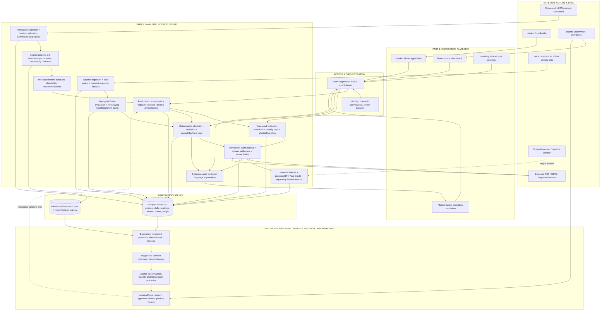

# DayCover+ 3.0 — Unified System Architecture & Product README

> **Team FIN-2 | Singapore–India Hackathon 2026 | Problem owner: Income Insurance**  
> **Document status:** Detailed target architecture / implementation blueprint (not proof that every component is built).  
> **Last reviewed:** 16 November 2026  
> **Primary market:** Singapore hawkers and stallholders.  
> **Core design principle:** **Rules decide payouts. ML informs product design. People approve changes.**

---

## 1. What is DayCover+?

DayCover+ is a proposed **parametric climate-income microinsurance platform** for Singapore hawkers who face income disruption from heavy rain and haze. It combines a transparent, contract-based insurance product with a low-friction payment experience, weather monitoring, livelihood analytics, and an insurer-facing product improvement system.

The product has **two connected systems**, backed by one shared policy authority:

1. **Experience Platform:** Hawker mobile/web interface, Income insurer dashboard, multilingual assistant, alerts and optional soundbox-style announcements.
2. **Main Intelligence Engine:** Policy registry; transaction and livelihood analytics; premium collection; official-weather ingestion; deterministic trigger, cap and settlement logic; audit ledgers; and an **offline insurer improvement lab**.

**What is genuinely differentiated:** DayCover+ does not merely ask *“Did a weather threshold cross?”* It also helps answer *“Was this coverage affordable and appropriate for this hawker, how well did it cushion disruption, and what should the insurer improve for future renewals?”* These analytical functions **never overturn a valid contractual trigger decision**.

### Product guardrails

- The contract defines which **official external index**, geographic area, observation window and threshold pay, before the event.
- A weather trigger is **necessary** for a parametric claim. ML-estimated sales loss cannot invent or deny claims.
- A **policy-year** begins on the issued inception/renewal anniversary, not on 1 January by default.
- The **contract premium**, **weekly collection cap**, **per-transaction collection amount** and **maximum benefit** are different values.
- Real partner integrations require agreements; a simulated SGQR/PayNow flow is clearly marked **DEMO**.
- No unapproved change to an active policy's premium, benefits, triggers or exclusions.
- Cash-dependent and low-data hawkers must have a viable coverage and billing route.
- Initial paying perils: **rain + haze** only; heat, short-storm and flood diagnostics are **non-paying shadow studies**.

---

## 2. Source of truth and contract versioning

The project has two active repositories and an experimental ML branch. They must not be treated as interchangeable implementations.

| Source | Purpose | Authority |
|---|---|---|
| [Research findings](https://github.com/harsh-pandhe/sih2026-research-findings) — especially [Finding 19](https://github.com/harsh-pandhe/sih2026-research-findings/blob/main/findings/19_multi_peril_financial_optimization.md) | Historical evidence, contract candidates, scientific and actuarial recommendations | **Research baseline / proposed product terms** |
| [Finding 18: rain/flood](https://github.com/harsh-pandhe/sih2026-research-findings/blob/main/findings/18_flood_trigger_research_daycover2.md) | Rain-trigger validation, short-storm shadow test, deferred blocked-access flood cover | Scientific evaluation |
| [Finding 18: heat](https://github.com/harsh-pandhe/sih2026-research-findings/blob/main/findings/18_heat_trigger_research_daycover2.md) | Hawker heat-cover deferral and WBGT shadow-test recommendation | Scientific evaluation |
| [`milestone-v1.2-core`](https://github.com/harsh-pandhe/sih2026-fin2/tree/milestone-v1.2-core) | Existing FastAPI service, deterministic engine, prototype app/dashboard, stored data and demo | **Current code**, but **not** identical to Finding 19 |
| [`ml-training`](https://github.com/harsh-pandhe/sih2026-fin2/tree/ml-training) | Weather-frequency models, synthetic merchant-impact experiments, fairness research, stress tests | Experimental model candidates, **not approved contract rules** |
| [Policy-anniversary draft PR #14](https://github.com/harsh-pandhe/sih2026-fin2/pull/14) | Review branch for anniversary-based historical replay and research integration specification | **Draft, not merged or production settlement ready** |
| **Issued policy schedule + `product_version_id`** | Signed-off price, benefits, limits, index definition, dates, exclusions, endorsements | **Ultimate source of truth for any real claim** |

**Required pre-integration decision:** Pick one approved research-backed contract configuration, encode it as a *versioned product*, reconcile the milestone code, and independently re-run pricing/replay. Never copy profitability results across different products as though they were equivalent.

### 2.1 Research-preferred pilot: Finding 19, Plan 4 (proposed)

| Rule | Research-recommended **DayCover+ Constrained Hawker Plan** |
|---|---|
| Product | Rain + haze; subject to Income Insurance approval |
| Haze index | NEA regional **24-hour PSI** using the contract-defined daily observation method |
| Moderate haze | PSI **≥101** for **two consecutive Singapore calendar days** → **S$30** on an eligible day; at most **3 moderate payout days** per policy year |
| Severe haze | PSI **≥201** on a single eligible day → **S$60**, at most **2 severe payout days** per policy year |
| Rain index | Daily total at the **contract-assigned NEA gauge** over 00:00–23:59 SGT |
| Rain benefit | Rain **≥70 mm** → **S$30**, on the **first eligible rain day per policy year** |
| Annual combined cap | **S$150** across rain and haze |
| Sub-allowances | **S$30 reserved for rain**; haze can pay at most **S$120** |
| Daily combined ceiling | **S$60** across paying perils on one day |
| Same-day rain + severe haze | Rain S$30 allocated first; haze gets at most S$30 of remaining daily allowance; **S$60 total**, not S$90 |
| Exclusions | Scheduled covered-location cleaning closures under the agreed contract; other exclusions require explicit policy wording |
| Example research price | **S$87/year (~S$1.67/week)**, **illustrative** rather than an insurer quote |
| Heat / independent flood / short-storm | **Not payable** in this proposed hawker pilot |

**Important mismatch:** The `milestone-v1.2-core` engine currently uses **PSI ≥151** for severe haze, S$150 haze plus S$30 rain (**S$180 combined potential**), and different day-count rules. Its current results cannot be labelled as proof of Finding 19's S$150 combined-cap design. The `ml-training` branch also models a different benefit and cap scheme. Neither should silently replace the research-preferred pilot.

**Policy decisions still needing insurer sign-off:** exact timestamp/finality of published indices, fallback gauge rights, rolling policy year and leap-day convention, treatment of closures and policy expiry, whether partially paid severe days count against severe-day allowance, and settlement timing. Finding 19's commercial assumptions about named reinsurance, sponsor support, payment fees and guaranteed solvency are **not verified agreements**.

---

## 3. One unified architecture diagram



**Interpretation:** All screens use one API and one versioned policy authority. Data/ML can **recommend a contract before issue**. The deterministic engine alone **determines the event-level benefit under the issued policy**. The optimisation lab is **read-only advisory** until Income explicitly authorises a *future* product version.

---

## 4. The complete eight-stage hawker-to-insurer pipeline

### Stage 1 — Onboard, verify, assign and obtain consent

1. Hawker opens the web/mobile app or an authorised partner flow.
2. Collect minimum identity/business details; verify stall/centre and eligibility through an approved flow (real Singpass integration is not implied by a demo button).
3. Identify the stall's geographic location, assigned NEA rain gauge, relevant regional PSI designation and scheduled centre closures.
4. Present the selected product's **exact triggers, benefit caps, exclusions, billing, withdrawal/cancellation and data use** in the user's chosen language.
5. Obtain separately auditable consent for optional transaction analysis; an uninsured hawker should not be forced to share all sales data merely to see the product.
6. Create `merchant_id`, `stall_id`, identity/access roles, consent record and proposal/quote identifier.

**Output:** Verified profile plus an auditable quote/onboarding trail. **No insurance cover exists until an approved policy is actually issued.**

### Stage 2 — Ingest transactions and build a trustworthy normal-sales baseline

1. Receive authorised read-only transaction events from a partner or the demo simulator; never silently modify a customer's existing SGQR flows.
2. Normalize timestamps to SGT; recognise reversals, refunds, payment-rail errors, multiple channel IDs, settlement delays and duplicates.
3. Aggregate **hourly/daily/weekly** digital transactions, completed sales, ticket sizes, active trading hours and data completeness.
4. Distinguish **digital receipts** from **total sales**: add optional, consented cash totals or range estimates, clearly marked as uncertain.
5. Generate weekday/time-of-day comparable baselines; model public holidays, declared rest days, known closures and seasonal changes.
6. Publish features with source, observation window, confidence and missingness flags—not invented precise daily income.

**Output:** A consented merchant feature profile and daily income-baseline **estimate**, not a certified account statement.

### Stage 3 — Estimate vulnerability and recommend suitable cover

1. Combine normal-sales predictions with historical local rain/haze indices and the merchant's sheltered/exposed business context.
2. Estimate a **range** of plausible lost gross profit on relevant bad-weather days, using margin, trading hours, delivery substitution and uncertainty.
3. Use partial pooling / empirical-Bayes shrinkage where only a few disruptive-weather events were observed; prefer a simple fallback when personal data are unreliable.
4. Compare **fixed baseline** cover against optional **income-sensitive benefit bands** before issue or renewal.
5. Enforce benefit suitability, affordability, fairness and insurer risk constraints.
6. Show the customer the benefit, premium, maximum payout and reasons; send any novel bands to Income for actuarial approval.

**Output:** A **recommendation**, never an immediate claim entitlement. The research-approved S$150 combined-cap hawker policy remains a distinct product version; income-sensitive plans are **future product candidates**, not a silent edit to it.

### Stage 4 — Issue policy and plan four-week micro-collections

1. Income approves and issues a policy with **version, effective start/end, index definitions, fixed benefits, annual caps and actual annual premium**.
2. Create a transparent **four-week collection calendar**; set the contractually permissible per-sale contribution and weekly collection ceiling.
3. As partner events arrive, compute an **accrual** up to the lower of the agreed amount, remaining weekly cap and outstanding authorised instalment. Actual funds become *collected* only after confirmed settlement.
4. Pause new contributions when the week's cap is reached; do not collect more than the authorised obligation.
5. Reconcile missed, failed or reversed payments; handle shortfalls via documented arrears/true-up, authorised bank debit or **confirmed** sponsor-funded support.
6. Four-week reviews may alter future *collection mechanics* only as disclosed and approved. They **must not** silently reprice the in-force insurance.

**Output:** A policy ledger, collection schedule, current-week progress and explicit unpaid balance or available credit.

### Stage 5 — Monitor verified climate and shadow experiments

1. Ingest timestamped official **NEA 24-hour regional PSI** and **assigned-station daily rain**; retain raw responses and data provenance.
2. Validate freshness, missing readings, source revisions, station identity and time-window completeness.
3. Apply **only the fallback method stated in the relevant policy version**; if required evidence is unavailable, create a **pending** case rather than recording zero rainfall.
4. Evaluate rain and haze under the approved paying rule set.
5. Also run independent **shadow** candidates—wettest-hour downpours, WBGT/heat and flood-access evidence—without creating monetary entitlements.
6. Send **forecast-based warnings as advisory notices only**; forecast cash benefits would require a separate approved insurance product.

**Output:** Quality-scored climate evidence, payable-trigger candidates and non-paying research events.

### Stage 6 — Make a deterministic, versioned claim decision

1. Resolve the actual **issued policy**, cover dates, relevant index, required consecutive days and closing/exclusion record.
2. Compute caps for **that policy year**, not the calendar year, accounting for all prior paid events—even when a historical replay is filtered to a short window.
3. Evaluate each eligible peril and apply agreed day-count, per-peril money, daily combined and overall annual limits **atomically**.
4. Apply the research Plan 4 compound-day sequence if that version is issued: **rain first (up to S$30), then haze**, up to the **S$60/day** ceiling and remaining haze allowance.
5. Produce a `paid`, `capped`, `excluded`, `pending` or `shadow` decision, with policy/version references, evidence and reason.
6. A sales decline, ML score or anomaly flag **cannot deny or delay** an otherwise valid payout merely because a merchant did not appear to lose money that day.

**Output:** An auditable **claim decision** with the exact contractual payable amount and remaining benefit balances.

### Stage 7 — Settle, communicate, renew and reward

1. Atomically reserve/post an approved claim using a unique event/policy/day key and a persistent ledger transaction.
2. Instruct the **insurer's authorised payment rail**; reconcile accepted, failed, returned and finally settled payments.
3. Update the hawker's policy display with payout receipt, weather proof, annual remaining cover, billing progress and plain-language explanation.
4. Send multilingual notifications; optional **phone-based soundbox simulation** announces the payout. Printed QR and external soundbox hardware are not necessary.
5. When the policy year ends, evaluate only the **approved** Dry-Year Credit/renewal rules; maintain sponsor-funded vouchers in a **separate** rewards ledger.
6. Ensure an expired policy is not treated as automatically renewed simply because an anniversary has passed.

**Output:** Reconciled premiums and claim ledger, customer communications, and a controlled renewal offer.

### Stage 8 — Learn from outcomes, advise Income, version future products

1. Compare independent weather evidence, claim outcomes, genuine or simulated business disruption, and observed premium collection.
2. Report **missed materially disrupted days**, paid days with low observed disruption, estimated loss-replacement ratio, premium burden and cash/digital inclusion.
3. Use existing **rain GLM**, **haze credibility**, **stall sensitivity** and **historical replay** models to compare alternative triggers and cover bands.
4. Extend the **NSGA-II Trigger Optimiser** with transparent multi-objective evaluation: affordability, protection effectiveness, product simplicity, portfolio capital risk and data uncertainty.
5. In the **Structure & Capital Lab**, stress-test correlated haze, rainfall, liquidity and reserve/reinsurance structures; do not assert actual treaty availability without a quote.
6. Require an actuary/legal/product review, versioned approval decision, customer notification and eligible future policy issuance before anything new affects payment terms.

**Output:** A **human-approved proposed next policy version**. Active-policy claims remain governed by their original issued terms.

---

## 5. Functional modules: every component we intend to have

### 5.1 Hawker Experience Platform

**Screens:**
- **Welcome + language choice:** English, Chinese, Malay and Tamil; accessibility, simple text, large buttons.
- **Onboarding and eligibility:** stall identity, centre, contact, consent, product/plan selection and transparent eligibility status.
- **My Cover:** policy number/version, start/end dates, rain gauge/PSI region, covered triggers, daily/annual remaining limits and exclusions.
- **Today / Weather Status:** most recent official observations with **source timestamp**; advisory forecasts clearly distinct from settlement readings.
- **Protection Recommendation:** comparative cover options, estimated affordability and uncertainty; explicitly label modelled/simulated benefits.
- **Premium Wallet / Collection Progress:** amount **owed** versus **actually collected**, this week's contribution total/cap, remaining instalment, charge history, refund and shortfall state. The wallet is a **ledger UI**, not proof DayCover holds merchant money.
- **Claims and Receipts:** pending/paid/capped/excluded cases, supporting NEA evidence, PayNow/mock receipt and remaining balance.
- **Renewal and Benefits:** actual renewal offer, possible Dry-Year Credit, optional third-party rewards and customer acceptance.
- **Multilingual AI Help:** explain an existing rule/decision; hand-off or dispute workflow for erroneous data and administrative questions.
- **Consent & Privacy:** optional feed connection, access history, retention summary and consent revocation.
- **Alerts / Soundbox:** payment notifications, severe-weather warnings, optional multilingual text-to-speech announcements.

**Acceptance:** Hawker can understand **what pays, what does not, what is charged, what has actually been received, and when coverage expires**, without reading code or trusting AI predictions.

### 5.2 Insurer / Underwriter Dashboard

- **Portfolio overview:** policies in force, centre/geographic breakdown, premium billed/received, unpaid obligations, booked payouts.
- **Live climate map:** PSI regions, assigned rain gauges, outages, index timestamps and affected centres.
- **Claim operations:** paid/pending/capped/excluded queues, weather evidence, duplicate alerts, payout status and reconciliation.
- **Exposure and accumulation:** remaining caps, island-wide haze accumulation, next-day forecast *cash requirements* and extreme-event scenarios.
- **Risk and fairness:** estimated protection gaps, gauge disagreement, cash-heavy versus QR-heavy access, unusual model behaviour, uncertain data.
- **Financial operations:** levy reconciliation, four-week collection performance, GIRO failures, subsidy balances, sponsor ledger and Dry-Year Credit forecast.
- **Product Design Lab:** current vs candidate triggers, Pareto trade-offs, replay charts, affordability/protection/capital comparisons.
- **Change approval:** proposed rule diff, source data, actuary sign-off, deployment effective date, archived version and rollback strategy for future issues.

**No insurer dashboard action may edit an issued customer's original contract terms retroactively without an explicit lawful endorsement process.** Catastrophe flags should alert/queue additional review and liquidity planning, not create an undisclosed automatic claims moratorium.

### 5.3 API Gateway, identity and integration orchestration

- FastAPI provides REST endpoints, validated requests and event streaming for clients.
- Authentication, consent, per-merchant isolation, insurer role control, audit trails and rate limits are required for production.
- Store **idempotency keys**, source identifiers and correlation IDs across weather, charge, claim and settlement events.
- Keep client/UI code free of payout formulas; **one** versioned rule engine owns them.
- Support local demo simulators when provider integrations are not available, with unmistakable `simulated: true` indicators.

### 5.4 Transaction ingestion and merchant analytics

**Inputs:** merchant-authorised transactions or sandbox POS events, amount, currency, channel, transaction timestamp, merchant/stall identifier, settlement reference and reversal/refund indicators.

**Derived features:** `transactions_per_hour`, `digital_revenue_per_day`, `ticket_median`, `active_hours`, `weekday_baseline`, `weekend_baseline`, `data_missingness_rate`, `cash_share_estimate` and trading-history length.

**Data-quality constraints:** transactions deduplicated by provider event ID; no impossible negative sales except tagged reversals; SGT conversion; source retention and permission tracking; no assumed zero sales during API outages; no claim-time cash inference from missing digital payments.

### 5.5 Livelihood / ML intelligence (advisory)

**Model 1 — Income Baseline:** Predict comparable expected sales per trading hour/day using weekday, hours, holidays, seasonality and recent trend. Start with robust non-ML baselines; adopt ML only if it beats them on time-split tests.

**Model 2 — Weather Impact:** Estimate likely loss of revenue/gross profit as a function of rain, PSI, shelter, opening hours and stall-level sensitivity. Use **empirical-Bayes partial pooling** to prevent overfitting merchants with few bad-weather observations. Show uncertainty intervals.

**Model 3 — Hazard frequency / pricing input:** Rain counts via regularised Poisson GLM with documented seasonal/ENSO sensitivity; haze via credibility-weighted frequency rather than overfitted tail classifiers. Refit only when data permits.

**Model 4 — Affordability / cover suggestion:** Compare pre-specified benefit bands under insurer-approved pricing, affordability, inclusion and risk constraints. Distinguish suggested **future contract** from the baseline issued product.

**Model 5 — Anomaly flags and fairness evaluation:** Flag suspicious data, stale feeds and instability to staff. Monitor differences by transaction-data availability and merchant type. **A model flag is not a contractual exclusion**.

**Not primary for Singapore hawkers:** Heat model remains a shadow/research item; RL reinsurance is exploratory and must not control real treasury or consumer claims.

**Evaluation:** time-based holdouts, no look-ahead, MAPE/MAE/sMAPE as appropriate for sales, Poisson deviance/calibration for triggers, false-positive/negative weather-to-loss metrics, payout-to-estimated-loss coverage, subgroup fairness, uncertainty and drift. Report actual-data results separately from synthetic-world performance.

### 5.6 Premium obligation, collection and cash/credit manager

Maintain **four distinct ledgers/fields**:

1. **Contractual premium owed** for the issued period.
2. **Scheduled instalment** and its due date.
3. **Accrued / authorised transaction-linked contributions** up to weekly/period caps.
4. **Confirmed received funds**, credits, reversals, arrears and subsidy disbursements.

A proposed per-sale contribution is a **collection method**, not an additional premium. Weekly cap changes must be disclosed, bounded and linked to an authorised four-week schedule. A capped week may undercollect—never mark the entire premium as paid unless cleared. Provide bank debit, arrears or an approved subsidy mechanism for cash-heavy merchants, subject to the actual contract.

**Partner limitation:** Merchant consent does not create a NETS API, wallet or automatic settlement-splitting permission. Real deployments require licensed/payment-provider agreements and insurer-controlled money movement. Demo collections must not be represented as live merchant deductions.

### 5.7 Official climate ingestion, QA and shadow rules

- Pull official NEA/MSS rainfall and regional PSI from supported sources; retain response, ingestion timestamp and version.
- Resolve stall → assigned rain station and PSI region using the approved product registry.
- Evaluate 00:00–23:59 SGT rain days and the contract-defined daily PSI statistic; handle consecutive PSI days and observation revisions.
- Validate station freshness and completeness, source drift, nearby-sensor anomalies and location mapping.
- Apply next-nearest gauge **within 5 km only if explicitly included in the issued policy**; otherwise keep events pending for review.
- **Paying:** rain/haze approved contract. **Shadow:** 80 mm comparison, lunch-hour downpour ≥20/28 mm in 60 minutes, hawker WBGT Candidate D, PUB flood/blocked-access diagnostics.
- Satellite/radar data can inform spatial research; **do not substitute it as an undisclosed payout trigger**.

### 5.8 Deterministic contract execution / payout engine

**Inputs:** immutable issued contract version, actual policy period, approved observations, closure calendar, prior benefit ledger and event identity.

**Execution:** (1) valid policy; (2) approved evidence; (3) threshold; (4) cleaning/exclusion; (5) per-peril counters; (6) daily/annual money limits; (7) compound-day prioritisation; (8) atomic claim event and payable amount; (9) settlement instruction.

**Invariants:** no payment for expired/never-issued policy; no paid event without evidence or approved contract conditions; never exceed annual/peril/day caps; no double-settlement; no calendar-year reset for anniversary-based policies; missing evidence is pending, not a negative observation; all results explainable and reproducible.

### 5.9 Settlement, accounting and renewal service

- Distinguish **decision**, **instruction submitted**, **accepted**, **failed/returned** and **settled**.
- Use durable event/claim uniqueness keys and DB transactions; an in-memory ledger alone is insufficient.
- Keep one auditable source of payment references, refunds and reversals.
- Dry-Year Credit is a **future-approved** renewal rule. The later phase-2 research proposes **5% of annual premium for a year with no haze payout**, subject to actuary review; an older prototype uses **25% after zero claims** and must not be copied by default.
- Partner rewards are separate from policyholder premiums and insurer technical reserves; no assumed sponsor commitment.
- Every issued renewal is a new approved policy term, with its own cap period and policy version.

### 5.10 Offline Trigger Optimiser & Structure/Capital Lab

- Reuse the repository's **NSGA-II** haze threshold/payout/cap optimiser as an *offline* starting point.
- Improve the old PSI-day basis-risk **proxy** with observed loss/payout mismatch when real hawker trading data eventually exist.
- Compare alternative rain/haze thresholds, daily benefit sizes, number-of-day caps and affordability / customer understanding.
- Produce product comparison reports: expected claims, high-percentile losses, capital/liquidity requirement, estimated protection ratio, fairness and uncertainty.
- Include scenario stress: consecutive haze days, compound rain/haze, weather-data outage, changing stall coverage, varying digital-payment adoption, no reinsurance and multiple hypothetical reinsurance costs.
- Separate **simulated solvency/financial assumptions** from confirmed insurer capital and treaty terms; do not call a historical backtest a solvency guarantee.
- Store a model proposal with supporting scripts, dataset hashes, validation period and approver. **Only a new signed version enters the product registry.**

---

## 6. Data strategy: observed, research-grounded and simulated

**Do not describe synthetic merchant income as actual Singapore hawker turnover.** Data provenance is part of the product design.

| Dataset family | Example sources | How it will be used | Evidence tier |
|---|---|---|---|
| Official rainfall / regional PSI | NEA, MSS, data.gov.sg | Actual historic/weather trigger evaluation | Real Singapore measurements |
| Centre coordinates, cleaning closures, PUB incident evidence | Hawker-centre open data and research repo | Stall location, exclusions and contextual hazard studies | Real/reference with mapping caveats |
| Singapore digital payment aggregates | Official programme/government summaries | Calibrate volume/ticket/order-of-magnitude scenarios | Aggregate, **not** merchant receipts |
| [Indonesian F&B MSME POS data](https://data.mendeley.com/datasets/kcgf45y24m/2) | Mendeley Data, CC BY 4.0 | Learn **foreign observed** receipt/timing patterns | Observed, **not Singapore hawker data** |
| [10-year quick-service restaurant + weather data](https://data.mendeley.com/datasets/9hntk3wbwc/1) | Mendeley Data, CC BY 4.0 | Study relationship between observed food sales and weather | Observed foreign commercial context |
| [One-year quick-service receipts + weather](https://data.mendeley.com/datasets/bfkvybtpj6/2) | Mendeley Data, CC BY 4.0 | Transaction baseline and weather methodology checks | Observed foreign commercial context |
| [`ml-training` simulated 6,665-stall book](https://github.com/harsh-pandhe/sih2026-fin2/blob/ml-training/docs/DATA_CARD.md) | Simulation using real Singapore weather and assumed behaviour | Stress-test collection and model mechanics | **Synthetic merchant outcomes** |
| Future consented SG hawker POS and optional cash records | Authorised pilot merchant/provider | Validate local sales baselines and actual weather-induced income loss | Desired **real local ground truth** |

### Proposed training-data schema

At minimum:

```text
merchant_id, stall_id, centre_id, timestamp_sgt, transaction_id,
payment_channel, amount_sgd, settlement_status, refund_flag,
source_dataset, observed_or_synthetic, consent_reference,
trading_open, planned_closure, product_category,
weather_day_sgt, assigned_gauge, rainfall_mm, psi_region, psi_daily,
weather_data_quality, model_version
```

At **daily/stall** granularity also produce `digital_turnover`, `optional_cash_turnover_or_range`, `complete_day_flag`, `comparable_baseline`, `observed_sales_delta`, `estimated_margin`, `estimated_lost_gross_profit`, `synthetic_loss_label`, `protected_trigger_event` and `claim_amount`—with strict separation of **observed** and **modelled** columns.

### Data pipeline

1. Download/record data sources, exact version, licence, citation and hash.
2. Normalize and remove/flag impossible entries; retain missing values as missing.
3. Recalibrate foreign POS distributions to **Singapore-specific aggregate constraints** without pretending they are local microdata.
4. Simulate multi-stall cash/digital/closure/refund/seasonality scenarios and separately simulate *hypothetical* weather responses on **real Singapore weather dates**.
5. Validate against held-out observed POS patterns; time-split all weather analyses.
6. Test the production contract engine independently of synthetic financial labels.
7. Replace simulated response assumptions with consented Singapore evidence as it becomes available.

**Known problems in `ml-training`:** alternative payout rules; synthetic weather-loss labels; a temporal look-ahead warning affecting historical cover-size comparisons; and the committed 2026 test reports **36.9% of paid simulated stall-events above simulated same-day loss**. Those need reconciliation before claiming real-world personalisation or overinsurance prevention.

---

## 7. Suggested persistence model and event contracts

**Postgres/PostGIS tables, some already present in the milestone repo, others proposed:**

| Entity/table | Required attributes | Notes |
|---|---|---|
| `merchants`, `stalls`, `centres` | IDs, location, centre, licence verification status, declared trading times | Minimise personal data |
| `consents`, `data_connections` | permitted purpose, source, timestamps, status, revocation | Separate opt-in from insurance assent |
| `product_versions`, `rule_sets` | version, thresholds, eligibility, caps, exclusions, effective date, approval signature | Immutable once issued against |
| `policies`, `policy_periods` | policy ID, merchant/stall, product version, start, end, renewal/end status | Anniversary-based limits |
| `raw_readings`, `curated_readings` | source/station/region, timestamp, index, quality and raw hash | Append-only evidence |
| `transactions`, `sales_aggregates` | provider reference, amount, settlement/reversal, hour/day totals, provenance | Data sharing opt-in |
| `quotes`, `benefit_recommendations` | model version, range, proposed band, affordability, explanation | Advisory; quote is not cover |
| `premium_obligations`, `collection_schedules` | fixed due, schedule interval, weekly cap, arrears policy, version | Distinct from sales |
| `collection_events`, `payment_receipts` | proposed levy, authorised transfer, actual settlement, reversals, sponsor credit | Ledger-backed |
| `trigger_events`, `claim_decisions` | policy ID, date, peril, evidence, exclusion/cap, amount, `rule_version` | Deterministic |
| `cap_balances` or event-derived aggregates | period, rain/haze/day counters, money remaining | Transactionally updated |
| `payout_instructions`, `payout_receipts` | idempotency key, insurer reference, status/attempt, timestamps | Prevent double pay |
| `renewal_credits`, `partner_rewards` | policy year, eligibility rule, approved credit/funding source | Keep sponsor separate |
| `model_versions`, `experiments`, `approvals` | training window, dataset hashes, performance, reviewer, future deployment date | Model governance |
| `audit_log` | actor, event, before/after reference, time, reason | Tamper-evident retention |

### Example policy object (illustrative contract representation; not a live issuance)

```json
{
  "product_version_id": "DAYCOVER-SG-HAWKER-RESEARCH-PLAN4",
  "status": "research_candidate_not_issued",
  "currency": "SGD",
  "annual_premium_example": 87.0,
  "haze": {
    "moderate_psi": 101,
    "moderate_consecutive_days": 2,
    "moderate_benefit": 30,
    "moderate_max_days": 3,
    "severe_psi": 201,
    "severe_benefit": 60,
    "severe_max_days": 2,
    "haze_annual_money_cap": 120
  },
  "rain": {
    "daily_mm": 70,
    "benefit": 30,
    "max_paid_days": 1,
    "rain_reserved_money_cap": 30
  },
  "daily_combined_cap": 60,
  "annual_combined_cap": 150,
  "same_day_priority": ["rain", "haze"],
  "policy_period_basis": "issued_policy_anniversary",
  "heat_or_flood_payable": false
}
```

**Production enhancement:** actual issued-policy records must include precise index calculation wording, source/fallback policy, dates, endorsement history and a version/hash; the research object above is only a teaching aid.

---

## 8. API design: existing milestones versus target routes

**Already documented in the milestone FastAPI service (examples; verify live behaviour before deployment):**

```text
GET  /health
GET  /rules
GET  /stalls
POST /quote
POST /engine/evaluate
POST /engine/replay
GET  /events
GET  /api/v1/telemetry/live
GET  /api/v1/policy/{stall_id}
GET  /api/v1/payouts/{stall_id}
POST /api/v1/triggers/simulate   # Demo only
POST /api/v1/concierge/chat     # Read-only answers
```

**Target endpoints to implement after product registry / identity work (illustrative names):**

```text
POST /v1/merchants/onboard
POST /v1/consents
POST /v1/integrations/merchant-transactions/webhook
GET  /v1/merchants/{id}/sales-baseline
POST /v1/quotes/recommend-protection
POST /v1/policies/issue                    # Insurer-authorised only
GET  /v1/policies/{id}/limits
GET  /v1/policies/{id}/collections
POST /v1/collections/reconcile            # Payment provider role
POST /v1/weather/evaluate                 # Internal job
POST /v1/claims/evaluate                  # Internal deterministic job
GET  /v1/claims/{id}/evidence
POST /v1/settlements/{id}/reconcile       # Insurer/provider role
GET  /v1/dashboard/accumulation
GET  /v1/dashboard/protection-effectiveness
POST /v1/lab/product-scenarios
POST /v1/lab/product-approvals             # Actuarial/product role
POST /v1/policies/{id}/renewal-offer
```

**API requirements:** typed request/response schemas, authorization, immutable event IDs, proper pagination, safe retry semantics, time zone handling, schema/model versioning and structured errors; payment endpoints must require approved roles and provider receipts.

---

## 9. Example demonstrations: exactly what a judge sees

### Demo A — New hawker and benefit recommendation

Select a prepared sample stall, show its verified/simulated sales history and assigned climate stations, display an earnings baseline with uncertainty, then compare the **research baseline contract** to a clearly labelled **future income-sensitive variant**. Demonstrate that no real personal data or actual insurance policy was created in the sandbox.

### Demo B — Small contributions with weekly cap

Simulate a series of S$5/S$10/S$20 digital food orders. Show the per-transaction **proposed accrual**, this week's remaining cap, a stop-at-cap transition, a new week, and a shortfall due to quiet trading. Separately show a real-looking *simulated* settlement receipt to demonstrate why accrual is not payment.

### Demo C — Heavy rain triggers a contract benefit

For a chosen historical or labelled simulated date, show the assigned gauge, source reading, **70 mm threshold**, cleaning-closure status, rain allowance and resulting **S$30** claim decision; display a demo PayNow receipt and a multilingual announcement.

### Demo D — Combined severe haze + rain is correctly capped

For Finding 19 Plan 4 only: set PSI **≥201**, rain **≥70 mm** on the same eligible day. Show nominal S$60 severe haze + S$30 rain, then apply **S$60 daily limit** to produce S$30 rain + S$30 haze, while respecting the S$150 annual combined limit and the preserved rain bucket. This is **not** the current milestone rule until implemented/repriced/approved.

### Demo E — Basis risk and the insurer improvement loop

Show a gauge-disagreement event or a labelled synthetic lost-sales day without a qualifying claim. Explain that no discretionary payout is made, but the event enters the *offline* Trigger Optimiser and basis-risk dashboard. Compare two future designs by coverage, premium and capital impact and display **human approval required**.

### Demo F — Renewal and loyalty

At a hypothetical anniversary, demonstrate zero/one payout and eligible/ineligible renewal credit states under a clearly marked **proposed** 5% no-haze-payout scheme. Keep sponsor vouchers separate. Show that a new coverage period is created only when renewed.

---

## 10. Validation checklist: what must pass

### Contract, claims and time

- [ ] The issued product version drives *every* UI, quote, simulation and payout computation.
- [ ] Boundary tests: PSI 100/101/200/201, rain 69.9/70.0 mm, day one/day two of haze.
- [ ] Test maximum three moderate haze and two severe haze payout days as Finding 19 specifies.
- [ ] Test rain S$30 ring-fencing, haze S$120 monetary subcap and S$150 combined cap.
- [ ] Test a same-day compound severe haze/rain event and partial curtailment.
- [ ] Test closure exclusions, expired policy, waiting periods if any, duplicate/revised weather data, late settlement and time-zone boundaries.
- [ ] Test a September-start policy across January 1; reset only at an authorised renewal anniversary.
- [ ] Test February 29, policy cancellation, endorsement and alternative policy-year definitions agreed by Income.
- [ ] Validate `replay` over full year vs a filtered slice yields identical paid/capped outcomes for the overlapping dates.
- [ ] Enforce caps atomically against concurrent duplicate workers or provider callbacks.

### Merchant sales and four-week collection

- [ ] Merchant/provider consent and source contract checked before ingestion.
- [ ] Refunds, duplicates, cash estimates, zero-vs-missing and delayed settlements handled.
- [ ] Weekly cap always respected; week/period boundaries defined contractually in SGT.
- [ ] Premium owed vs accrued vs collected vs reversed never conflated.
- [ ] Cash-heavy and low/no-data merchant can still access a clearly priced standard alternative.
- [ ] Four-week changes do not retroactively alter coverage or exceed customer authorisation.

### ML, actuarial, fairness and governance

- [ ] Time-based validation; no future QR or weather observations in a historical quote.
- [ ] Simple baseline compared with ML and model uncertainty reported.
- [ ] Synthetic losses clearly labelled and never described as observed SG hawker losses.
- [ ] Revenue impact, cash-share and protected-group proxy biases evaluated before deployment.
- [ ] Payouts never depend on a model saying today's observed revenue fell enough.
- [ ] Optimiser output requires independent actuarial review and product/legal approval.
- [ ] Reinsurance/sponsor assumptions are not shown as confirmed partnerships or guaranteed profits.

### Security and operational readiness

- [ ] Least-privilege roles, merchant isolation, encryption, audit logging and consent revocation.
- [ ] Source timestamp and last-updated state shown to users; no stale feed represented as live.
- [ ] Payment reconciliation, retries, rollback, outage and incident response tested.
- [ ] All personal data excluded from LLM prompts unless separately evaluated and authorised.

---

## 11. Suggested development organisation and repo layout

**Do not create another competing claim engine.** Keep `src/daycover` as the single contract-evaluation foundation once its rules are aligned with the approved research product. The paths below are **proposed additions**, not a claim that they already exist.

```text
sih2026-fin2/
├── mobile/daycover_app/                 # Existing Flutter client foundation
├── dashboard/                           # Existing React insurer dashboard foundation
├── src/daycover/                        # Existing FastAPI + deterministic engine
│   ├── api.py
│   ├── rules.py
│   ├── engine.py
│   ├── data.py
│   ├── db.py
│   └── ...
├── src/platform/                        # PROPOSED access / consent / integration services
│   ├── identity/
│   ├── consents/
│   └── partner_connectors/
├── src/livelihood/                      # PROPOSED sales and ML advisory modules
│   ├── transactions/
│   ├── income_baseline/
│   ├── weather_impact/
│   └── protection_recommendations/
├── src/billing/                          # PROPOSED collection and premium accounting
│   ├── obligations/
│   ├── four_week_scheduler/
│   ├── collection_ledger/
│   └── shortfalls_and_credits/
├── src/settlement/                       # PROPOSED persisted claim and payment workflow
│   ├── policy_periods/
│   ├── claim_posting/
│   └── payment_reconciliation/
├── src/research_lab/                     # PROPOSED offline adviser, no payout access
│   ├── basis_risk/
│   ├── trigger_optimiser/
│   ├── capital_stress/
│   └── fairness_and_backtest/
├── scripts/                              # Existing data and research scripts
├── tests/                                # Existing tests + new contract/collection tests
├── migrations/                           # Existing database migrations + new tables
├── docs/                                 # Product/spec/architecture/validation documents
└── phase2-gateway-demo/                  # Existing checkout mirror/demo
```

### Suggested ownership / workstreams

| Workstream | Deliverable | Priority |
|---|---|---|
| **Contract / Actuarial** | Reconcile Finding 19's Plan 4 vs current code; produce one approved, immutable rule definition and replay | **P0** |
| **Core Engineering** | Issued-policy dates, limits, simultaneous claims, persistent settlement and audit records | **P0** |
| **Transaction & Billing** | Merchant data abstraction, sales simulator, weekly cap, four-week scheduler, reconciliation | **P0/P1** |
| **Livelihood / ML** | Normal-sales baseline, weather impact, uncertainty, fairness; offline protection recommendations | **P1** |
| **Weather / Data** | Official readings, QA, station mapping, pending cases, non-paying shadow tests | **P0/P1** |
| **Insurer Dashboard** | Exposure, unpaid premium, payout explanation, basis-risk and lab comparisons | **P1** |
| **User Experience** | Mobile/web coverage, billing progress, payout timeline, multilingual alerts/soundbox | **P1** |
| **Optional Commercial** | Partner rewards, Dry-Year Credit, external payment agreement, sponsor funding | **P2** |
| **Research Extensions** | Full capital/treaty experiments, RL and non-hawker occupational heat | **P2 / later** |

---

## 12. Roadmap — deliver the architecture in stages

**Milestone 0 — Authority & correctness:** Finalise one research-backed pilot product; resolve mismatch with `src/daycover/rules.py`; fix policy-year and overlap caps; build regression fixtures. Do **not** present an unmerged draft PR as production.

**Milestone 1 — Full working demo:** Hawker app, insurer dashboard, real historical official weather, one deterministic contract version, simulated PayNow settlement, audible messages and complete audit/claim trace.

**Milestone 2 — Transaction-aware collection:** Stable simulator, consent architecture, four-week collection schedule, weekly cap, ledger, undercollection and cash-heavy alternatives. All merchant transfers clearly simulated until a partner is confirmed.

**Milestone 3 — Livelihood intelligence:** Ingest research POS data, calibrate Singapore-appropriate transaction worlds, train robust daily/hourly baselines and weather-impact models, report uncertainty and fairness. Do not claim real hawker income validation yet.

**Milestone 4 — Product Improvement Lab:** Measure payout-versus-estimated disruption, run the trigger optimiser against identical versioned contracts, add capital/liquidity scenario comparison and insurer approval workflow.

**Milestone 5 — Pilot & commercial readiness:** Obtain authorised real hawker transaction records and partner integrations; independently validate income effects, insurer pricing/legal terms, privacy, banking and reconciliation before issuing real cover.

---

## 13. What DayCover+ will **not** claim

- ❌ “We have integrated real NETS/SGQR wallet deductions” unless a provider has authorised and demonstrated them.
- ❌ “Income Insurance has commercially approved our final S$87 product” until it actually does.
- ❌ “Munich Re/NTUC/FairPrice is funding or backing the product” without a confirmed agreement.
- ❌ “Modelled weather income loss is observed hawker loss” when synthetic or foreign POS data were used.
- ❌ “The model decides payouts” — the issued, deterministic rulebook decides.
- ❌ “The 2015/2019/2026 replay proves guaranteed solvency” — it is historical and assumption-sensitive evidence, not a capital guarantee.
- ❌ “Heat and flood are already paying hawker perils” — they are deferred/shadow under the cited research.
- ❌ “The whole `ml-training` pricing book can merge unchanged” — its payout rules and data provenance differ from Finding 19.

---

## 14. Evidence and reference links

### Team primary research

- [Research repository — main index](https://github.com/harsh-pandhe/sih2026-research-findings)
- [Finding 19 — Contract comparison, payout caps and financial optimisation](https://github.com/harsh-pandhe/sih2026-research-findings/blob/main/findings/19_multi_peril_financial_optimization.md)
- [Finding 18 — Hawker heat research](https://github.com/harsh-pandhe/sih2026-research-findings/blob/main/findings/18_heat_trigger_research_daycover2.md)
- [Finding 18 — Rain, flooding and shadow triggers](https://github.com/harsh-pandhe/sih2026-research-findings/blob/main/findings/18_flood_trigger_research_daycover2.md)
- [Corrections / uncertainty register](https://github.com/harsh-pandhe/sih2026-research-findings/blob/main/findings/17_corrections_and_robustness.md)
- [Historical Trigger Optimiser](https://github.com/harsh-pandhe/sih2026-research-findings/blob/main/findings/05_trigger_optimiser.md)

### Implementation and ML branches

- [Milestone architecture](https://github.com/harsh-pandhe/sih2026-fin2/blob/milestone-v1.2-core/docs/ARCHITECTURE_AND_PROJECT.md)
- [Current deterministic payout rules](https://github.com/harsh-pandhe/sih2026-fin2/blob/milestone-v1.2-core/src/daycover/rules.py)
- [Current payout engine](https://github.com/harsh-pandhe/sih2026-fin2/blob/milestone-v1.2-core/src/daycover/engine.py)
- [Phase-2 micro-collection and Dry-Year Credit proposal](https://github.com/harsh-pandhe/sih2026-fin2/blob/milestone-v1.2-core/docs/PHASE2_CHECKOUT_PREMIUM_DESIGN.md)
- [ML model pipeline](https://github.com/harsh-pandhe/sih2026-fin2/blob/ml-training/docs/PIPELINE.md)
- [ML data provenance and known limitations](https://github.com/harsh-pandhe/sih2026-fin2/blob/ml-training/docs/DATA_CARD.md)
- [ML audit checks](https://github.com/harsh-pandhe/sih2026-fin2/blob/ml-training/scripts/audit_models.py)
- [Draft PR #14 — Policy anniversary correction](https://github.com/harsh-pandhe/sih2026-fin2/pull/14)

### External research transaction data — candidates for separate validation and ingestion

- [Mendeley: Indonesian F&B MSME anonymous transactions, version 2 (2026), CC BY 4.0](https://data.mendeley.com/datasets/kcgf45y24m/2)
- [Mendeley: 25 quick-service sandwich locations, transaction and weather data (2025), CC BY 4.0](https://data.mendeley.com/datasets/9hntk3wbwc/1)
- [Mendeley: Sandwich Analytics Part II, receipts and weather (2020), CC BY 4.0](https://data.mendeley.com/datasets/bfkvybtpj6/2)

Source URLs above are references, not an assertion that each research dataset is already downloaded, transformed or validated in the DayCover training pipeline.

---

## 15. One-sentence explanation for judges

> **DayCover+ combines verified, automatic weather-triggered income protection with affordable premium collection, income-aware cover recommendations, and an evidence-based insurer improvement loop—while keeping every real payout bound to a transparent, pre-agreed contract.**

**Bottom line:** The goal is not “the most AI features.” The goal is **more meaningful protection for hawkers, transparent collections and claim decisions, and measurable learning that helps Income improve future coverage without changing today's promise.**
